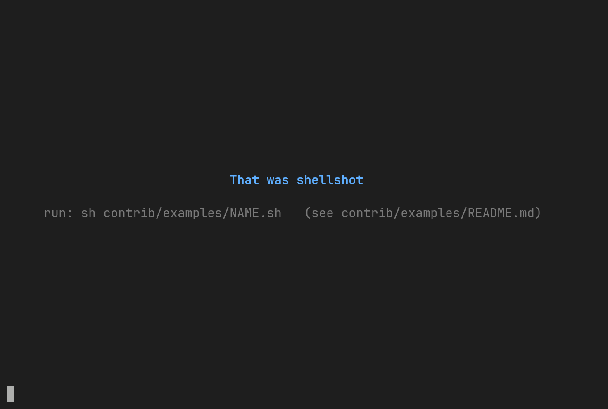

<h1 id="shellshot"><picture><source media="(prefers-color-scheme: dark)" srcset="docs/assets/logo-dark.svg"></picture></h1>

[![Release][release-badge]][release]
[![GoReleaser][goreleaser-badge]][goreleaser]
[![Licence][license-badge]][license]
[![AI Coded: Claude 5.5][ai-badge]][ai]

[release]: https://github.com/mikelorant/shellshot/releases
[release-badge]: https://img.shields.io/github/v/release/mikelorant/shellshot
[goreleaser]: https://github.com/mikelorant/shellshot/actions/workflows/release.yml
[goreleaser-badge]: https://github.com/mikelorant/shellshot/actions/workflows/release.yml/badge.svg
[license]: LICENSE
[license-badge]: https://img.shields.io/github/license/mikelorant/shellshot
[ai]: https://www.anthropic.com/claude
[ai-badge]: https://img.shields.io/badge/AI_Coded-Claude_5.5-D97757?logo=anthropic&logoColor=white

Shellshot records a terminal session and turns it into an image. It runs your shell, or a single
command, on a pseudo-terminal (a fake terminal that a program can write to). A headless terminal
(one with no window), [libghostty](https://github.com/ghostty-org/ghostty), reads the output.
Shellshot stores it as a compact event log, a `.shot` file. You can replay the file in your
terminal, or export it as an animated PNG, GIF, WebP or SVG. A script can drive the session, so a
recording does not depend on your typing.

[![Highlights][highlights-badge]](#-highlights-)
[![First Steps][first-steps-badge]](#-first-steps-)
[![Why Shellshot][why-shellshot-badge]](#-why-shellshot-)
[![Installation][installation-badge]](#-installation-)
[![Usage][usage-badge]](#-usage-)
[![Common Tasks][common-tasks-badge]](#-common-tasks-)
[![Scripting][scripting-badge]](#-scripting-)
[![Built With][built-with-badge]](#-built-with-)

[highlights-badge]: https://img.shields.io/badge/-💡_Highlights-ff0000
[first-steps-badge]: https://img.shields.io/badge/-🐾_First_Steps-ffa500
[why-shellshot-badge]: https://img.shields.io/badge/-💬_Why_Shellshot-ffff00
[installation-badge]: https://img.shields.io/badge/-💾_Installation-008000
[usage-badge]: https://img.shields.io/badge/-🎛_Usage-0000ff
[common-tasks-badge]: https://img.shields.io/badge/-🧰_Common_Tasks-4b0082
[scripting-badge]: https://img.shields.io/badge/-📜_Scripting-ee82ee
[built-with-badge]: https://img.shields.io/badge/-🧱_Built_With-ff69b4



## 💡 Highlights [⭡](#shellshot)

- **Records any session:** Captures your interactive shell, or a single command, through a headless
  libghostty terminal.
- **Compact `.shot` log:** Stores events in a binary log with zstd compression. It stays small, and
  it survives a crash.
- **Replay in your terminal:** Plays a recording back with its original timing. It caps long idle
  gaps and prints a summary when it ends.
- **Exports four formats:** Writes an animated PNG (the default), GIF, WebP or SVG (still or
  animated). The encoders are written in Go, so you need no browser and no ffmpeg.
- **Faithful rendering:** Draws colours and text styles, wide characters and CJK, colour emoji
  (Apple-style or Noto), box-drawing and Powerline glyphs, and JetBrains Mono with Nerd Font
  symbols.
- **Scriptable recordings:** Uses a `.script` language to drive the session, so a recording does not
  depend on your typing.
- **Runs anywhere:** Ships release binaries for macOS and Linux (amd64 and arm64), and a multi-arch
  container image.

## 🐾 First steps [⭡](#shellshot)

1. Download the release for your platform. Run the command that matches your computer. It saves
   the `shellshot` program in the current folder.

   macOS on Apple silicon:

   ```sh
   curl -fsSL https://github.com/mikelorant/shellshot/releases/latest/download/shellshot_darwin_arm64.tar.gz | tar xz shellshot
   ```

   macOS on Intel:

   ```sh
   curl -fsSL https://github.com/mikelorant/shellshot/releases/latest/download/shellshot_darwin_amd64.tar.gz | tar xz shellshot
   ```

   Linux on amd64 (x86-64):

   ```sh
   curl -fsSL https://github.com/mikelorant/shellshot/releases/latest/download/shellshot_linux_amd64.tar.gz | tar xz shellshot
   ```

   Linux on arm64:

   ```sh
   curl -fsSL https://github.com/mikelorant/shellshot/releases/latest/download/shellshot_linux_arm64.tar.gz | tar xz shellshot
   ```

2. Record a session. This starts your shell. Run a few commands, then type `exit` to stop.

   ```sh
   ./shellshot record --output example.shot
   ```

3. Replay the recording to check it.

   ```sh
   ./shellshot replay example.shot
   ```

4. Export the recording as an image. This writes `example.png` next to the recording.

   ```sh
   ./shellshot export example.shot
   ```

## 💬 Why Shellshot? [⭡](#shellshot)

Many tools that make terminal images drive a headless browser, such as Chrome, to draw the
terminal. That is heavy to install and to run. The result can also be unreliable: the timing or the
drawing often does not match what a real terminal shows. Many of these tools also tie recording and
image-making together, so a small change to the image means a new recording.

Shellshot takes a different route. It uses libghostty, the engine of the Ghostty terminal, so the
screen is accurate. It also splits recording from encoding. Record once to a small `.shot` file,
then export it as many times, and in as many formats, as you like. You never run the session again.
Shellshot is one self-contained program. It needs no browser and no ffmpeg, so there are few outside
parts to install or break.

## 💾 Installation [⭡](#shellshot)

macOS on Apple silicon:

```sh
curl -fsSL https://github.com/mikelorant/shellshot/releases/latest/download/shellshot_darwin_arm64.tar.gz | tar xz shellshot
```

macOS on Intel:

```sh
curl -fsSL https://github.com/mikelorant/shellshot/releases/latest/download/shellshot_darwin_amd64.tar.gz | tar xz shellshot
```

Linux on amd64 (x86-64):

```sh
curl -fsSL https://github.com/mikelorant/shellshot/releases/latest/download/shellshot_linux_amd64.tar.gz | tar xz shellshot
```

Linux on arm64:

```sh
curl -fsSL https://github.com/mikelorant/shellshot/releases/latest/download/shellshot_linux_arm64.tar.gz | tar xz shellshot
```

## 🎛 Usage [⭡](#shellshot)

Run `./shellshot` on its own to see the commands:

```text
Record and replay terminal screen snapshots

Usage:
  shellshot [command]

Available Commands:
  completion  Generate the autocompletion script for the specified shell
  export      Render a recording as an animated PNG
  help        Help about any command
  info        Show the header and statistics of a recording
  record      Record an interactive shell or command to a file
  replay      Play a recording to stdout with its original timing
  version     Print the shellshot version

Flags:
  -h, --help   help for shellshot

Use "shellshot [command] --help" for more information about a command.
```

### record

```text
Record runs $SHELL (or /bin/sh), or the command given with -c or after --, on a live terminal and records its output with timing. Recording ends when the command exits.

Keystrokes are not recorded unless --record-input is set.

With --script FILE the session is run by a script (see docs/scripting.md) instead of by you. --list prints what the script would do and runs nothing. -o, --cols and --rows given on the command line win over the script's output and size.

Usage:
  shellshot record [-o file] [-c command] [--cols N] [--rows N] [--record-input] [--coalesce DURATION] [--codec none|flate|zstd] [--ignore-exit-status] [-- command [args...]]
       shellshot record --script FILE [--list] [--watch] [-o file] [--cols N] [--rows N] [--record-input] [flags]

Flags:
      --coalesce duration    merge output events closer together than this (0 keeps every read separate)
      --codec string         block compression: none, flate or zstd (default "zstd")
      --cols int             terminal width in cells
  -c, --command string       shell command string to run with $SHELL -c
  -h, --help                 help for record
      --ignore-exit-status   exit 0 even if the command exits non-zero
      --list                 with --script: print the plan and its estimated duration, run nothing
  -o, --output string        recording file (default shellshot-YYYYMMDD-HHMMSS.shot)
      --record-input         also record the keystrokes sent to the command
      --rows int             terminal height in cells
      --script FILE          run the script FILE and record it instead of an interactive shell
      --watch                with --script: show the terminal output on stdout while the script runs
```

### replay

```text
Play a recording to stdout with its original timing

Usage:
  shellshot replay FILE [--speed f] [--idle-limit d] [--keep-leading-blank] [--fps n] [--clear] [--no-crop] [-q] [--color auto|always|never] [flags]

Flags:
      --clear                 clear the screen before each frame (default: only when stdout is a terminal)
      --color string          colour output: auto (terminal and NO_COLOR unset), always or never (default "auto")
      --fps int               frame sampling rate in frames per second (default 60)
  -h, --help                  help for replay
      --idle-limit duration   longest pause between frames, before --speed (0 for no limit) (default 2s)
      --keep-leading-blank    keep a blank screen at the start of the animation
      --no-crop               do not crop frames larger than the terminal (they scroll and wrap on every redraw)
  -q, --quiet                 do not print the summary shown on stderr after a replay that draws in place
      --speed float           playback speed multiplier (2 plays twice as fast) (default 1)
```

### export

```text
Render a recording as an animated PNG

Usage:
  shellshot export FILE [-o OUT.png] [flags]

Flags:
      --adjust-cell-height string   change the cell height after --scale, in pixels or percent; text stays vertically centred, like Ghostty's adjust-cell-height; the result must be 1 px to 10x the font cell (default "0")
      --adjust-cell-width string    change the cell width after --scale, in pixels (-1, 2) or percent (-7%), like Ghostty's adjust-cell-width; the result must be 1 px to 10x the font cell (default "0")
      --cursor string               cursor shape: block, bar, underline or none (default "block")
      --emoji-font file             COLR v0 or CBDT/CBLC colour emoji font file, tried before the --emoji-set fonts for every emoji
      --emoji-set string            colour emoji artwork: apple or noto. apple draws Apple Color Emoji, whose artwork belongs to Apple Inc. and is not open source, and takes the few emoji it lacks from Noto. noto draws Noto Color Emoji only (SIL OFL 1.1): the licence-clean choice for exports you share (default "apple")
      --fallback-font file          TTF/OTF/TTC file for glyphs the built-in fonts lack (repeatable; tried in order, after the built-in fonts)
      --font-size float             font size in pixels, before --scale (12 matches Ghostty font-size = 12 on a 2x display with --scale 2) (default 15)
      --format string               output format: png, gif, svg, webp (default: from the extension of -o, else png)
      --fps int                     frame sampling rate in frames per second (default 60)
      --frame string                write one frame as a still instead of the animation (svg only): first, last, or a time on the output clock such as 1.5s
      --gif-colors int              gif: largest number of picture colours in the palette (2 to 255; one more entry is transparent) (default 255)
      --gif-dither                  gif: dither when the animation has more colours than the palette (adds noise, so files grow)
  -h, --help                        help for export
      --hold duration               how long the final frame stays on screen; when given, scene holds are ignored (without it a scene hold is added to this one where a scene ends) (default 2s)
      --idle-limit duration         longest pause between frames, before --speed (0 for no limit); when given, replaces the idle limit of every scene (default 2s)
      --keep-leading-blank          keep a blank screen at the start of the animation
      --loops int                   number of times the animation plays (0 for forever)
      --min-delay duration          shortest frame delay; shorter frames are merged into the previous one (0 to keep all) (default 20ms)
      --no-hints                    ignore the speed, idle and hold hints stored in the recording's scenes (hidden spans are still cut)
  -o, --output string               output file, written as-is (default: FILE with the extension of the format, .png for png)
      --padding int                 border around the screen in pixels (at least 1), before --scale (default 8)
      --poster string               png only: the frame viewers without animation support show (Preview, Quick Look, chat previews): first, last, none or a time such as 12s on the output clock. A poster other than the first frame adds one full frame to the file (default "last")
      --scale int                   integer scale factor for font size and padding (default 1)
      --show-hidden                 render hidden spans like the rest of the recording instead of cutting them
      --speed float                 playback speed multiplier (2 plays twice as fast); when given, replaces the speed of every scene (default 1)
      --svg-text string             how svg draws text: text (small, selectable, drawn in the viewer's monospace font) or paths (glyph outlines of the built-in fonts, exact but larger) (default "text")
      --system-fonts                also use installed CJK and symbol fonts (macOS and Linux font folders); the output then depends on this machine's fonts
      --theme string                built-in theme name (dark, light) or a theme JSON file (default: dark)
```

## 🧰 Common tasks [⭡](#shellshot)

### Record

Run one command instead of a shell. The recording ends when the command does.

```sh
./shellshot record --command 'ls -la' --output ls.shot
```

Fix the terminal size, in columns and rows.

```sh
./shellshot record --cols 100 --rows 30 --output wide.shot
```

Choose the file name with `--output`. Without it, the name comes from the start time, such as
`shellshot-20261108-093045.shot`.

Record a full-screen program, such as `vim`. Put the command after `--`. The recording ends when you
quit the program.

```sh
./shellshot record --output vim.shot -- vim notes.txt
```

### Export

Pick a format: `png` (the default), `gif`, `webp` or `svg`. The file takes the recording's name with
the format's extension.

```sh
./shellshot export example.shot --format gif
```

Choose the still image that viewers without animation support show, such as macOS Preview. Use
`first`, `last` (the default), `none` or a time. This works for PNG only.

```sh
./shellshot export example.shot --poster first
```

Change the theme (`dark` or `light`), the font size and the emoji artwork (`apple` or `noto`).

```sh
./shellshot export example.shot --theme light --font-size 18 --emoji-set noto
```

Play faster, and cap the pauses. `--idle-limit 0` keeps every pause.

```sh
./shellshot export example.shot --speed 2 --idle-limit 1s
```

## 📜 Scripting [⭡](#shellshot)

A script lets shellshot type into a shell for you, so a recording does not depend on your typing.
A `.script` file lists settings first, then steps. Steps run in order and can be grouped into
scenes. A hidden block is recorded, but export can drop it. A script has no conditions, loops or
variables. Shellshot checks the whole file before it starts anything.

This script records a small Go program being written in `vim`, built and run. It needs Go and `vim`
on your machine. Save it as `hello.script`:

```text
# hello.script
size 80x24
typing 40ms
timeout 10s

hidden setup {
  run mkdir -p /tmp/hello
  run cd /tmp/hello
  run clear
}

scene edit {
  run vim --cmd 'filetype plugin indent on' main.go
  press i
  type lines {
    package main

    import "fmt"

    func main() {
    fmt.Println("Hello, Shellshot")
    }
  }
  press esc
  type ":wq\n"
}

scene build {
  hidden {
    run go mod init hello
  }
  run go build -o hello
  run ./hello
}
```

Run it. The script leaves its files in `/tmp/hello`.

```sh
./shellshot record --script hello.script --output hello.shot
```

Add `--list` to check a script and see its plan without running it. Add `--watch` to see the
terminal while it runs.

### Where settings go

- Process settings (`size`, `shell`, `env`, `cwd`, `seed`, `output`) go before the first step.
- Behaviour settings (`typing`, `jitter`, `timeout`, `settle`, `linger`) go anywhere. Inside a
  block, one applies until the closing `}` and then reverts.
- Export hints (`speed`, `idle`, `hold`) go before the first step, or inside a scene.

### Commands

| Command | What it does |
|---|---|
| `run TEXT` | Types the text, presses Enter, then waits for the screen to go quiet. |
| `type TEXT` | Types the text without pressing Enter. |
| `press KEY...` | Presses keys, such as `enter`, `esc` or `ctrl+c`. Add `x3` after a key to repeat it. |
| `wait PATTERN [TIMEOUT]` | Waits until the screen shows a quoted text or matches a `/regex/`. With `0s` it checks once and fails at once if there is no match. |
| `wait idle [DURATION]` | Waits until the screen has had no output for the duration. |
| `sleep DURATION` | Pauses. |
| `mark LABEL` | Adds a named marker to the recording. |

A duration needs a unit: `500ms`, `2s` or `1m`.

### Options

| Option | Default | What it does |
|---|---|---|
| `size` | your terminal's size, else `80x24` | Sets the terminal size, as `COLSxROWS`. |
| `shell` | `$SHELL`, else `/bin/sh` | Sets the program to start, with optional arguments. |
| `env` | inherited | Sets a variable, as `KEY=VALUE`. Repeat the line for more. |
| `cwd` | the current folder | Sets the folder to start in. |
| `seed` | `1` | Seeds the random variation of `jitter`, so a run can be repeated. |
| `output` | `shellshot-YYYYMMDD-HHMMSS.shot` | Sets the recording file. `--output` on the command line wins. |
| `typing` | `50ms` | Sets the delay between typed characters. |
| `jitter` | `0%` | Varies `typing` by up to this much, from `0%` to `100%`. |
| `timeout` | `15s` | Sets how long `wait` and `run` wait before they fail. |
| `settle` | `200ms` | Sets how long the screen must stay quiet after `run`. `off` turns it off. |
| `linger` | `0s` | Pauses after every step, so a viewer can read. |
| `speed` | the export's speed | Sets the export's playback speed, such as `8x`, for a span. |
| `idle` | none | Caps each pause in the export, for a span. |
| `hold` | none | Adds time on the last screen of a span in the export. |

### Blocks

A block groups steps. It holds at least one step. Names use letters, digits, `_` and `-`, and each
name can be used once.

A `scene` gives a group of steps a name. `./shellshot info` lists the scenes, and export hints can
apply to one scene.

```text
scene greet {
  run echo hello
  run echo goodbye
}
```

A `hidden` block runs and is recorded, but export cuts it out. The name is optional.

```text
hidden {
  run clear
}

hidden setup {
  run mkdir -p /tmp/demo
  run cd /tmp/demo
}
```

A hidden block can sit inside a scene. This is the only nesting allowed.

```text
scene build {
  hidden {
    run go mod init demo
  }
  run go build
}
```

A behaviour setting inside a block applies until the closing `}`, then goes back to its old value.
Here `typing` is slow in `slow` and back to `40ms` in `normal`.

```text
typing 40ms

scene slow {
  typing 120ms
  run echo typed slowly
}

scene normal {
  run echo typed at 40ms again
}
```

A text block types many lines as one step. With `lines`, each line is typed with Enter after it.

```text
run lines {
  echo one
  echo two
}
```

With `paragraphs`, the lines of a paragraph join into one line, and a blank line starts a new
paragraph.

```text
type paragraphs {
  This is one sentence
  on two lines.

  This is a second paragraph.
}
```

At the end of every script, shellshot exits the shell for you, inside an implicit hidden block.

## 🧱 Built with [⭡](#shellshot)

| Component | Used for | Licence |
|---|---|---|
| libghostty-vt | The terminal engine. Built from the Ghostty source in `third_party/ghostty` and linked statically. | MIT |
| [go.mitchellh.com/libghostty](https://pkg.go.dev/go.mitchellh.com/libghostty) | The Go binding for libghostty. | MIT |
| JetBrains Mono | The text font. | SIL OFL 1.1 |
| Symbols Nerd Font Mono | Icon and symbol glyphs. | MIT |
| Noto Sans Mono CJK SC (subset) | Chinese, Japanese and Korean characters. | SIL OFL 1.1 |
| Apple Color Emoji (compact derivative) | The default colour emoji. | Apple Inc., not open source |
| Noto Color Emoji | The other colour emoji set, and a fallback for the Apple set. | SIL OFL 1.1 |
| [nativewebp](https://github.com/HugoSmits86/nativewebp) | Writes lossless WebP. | MIT |
| [klauspost/compress](https://github.com/klauspost/compress) | The zstd compression in `.shot` files. | BSD-3-Clause |

The Apple emoji artwork belongs to Apple Inc. The MIT licence does not cover it. Use
`--emoji-set noto` to avoid it. See [NOTICE](NOTICE) for details.

The PNG and GIF encoders use Go's standard library. The animated PNG and SVG writers are part of
this project. [NOTICE](NOTICE) lists every Go module and every licence.
